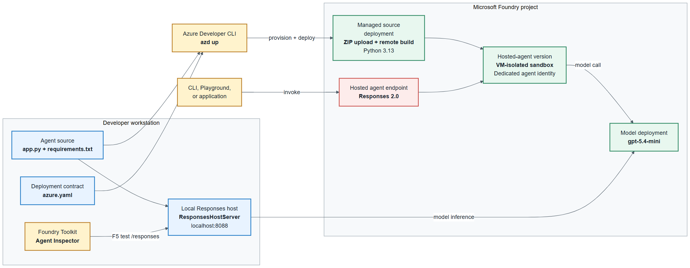
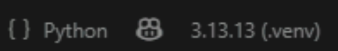
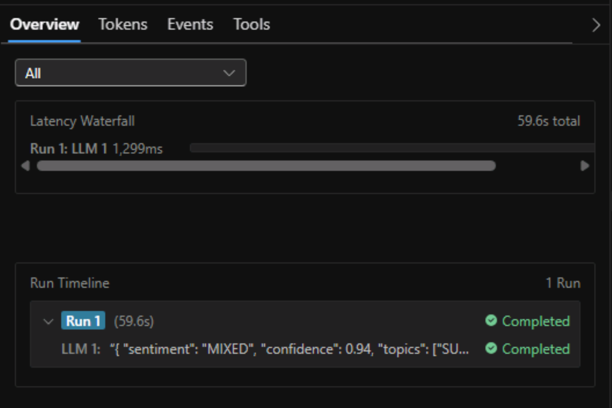
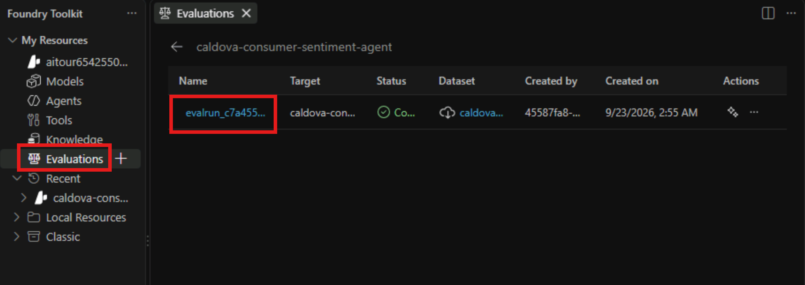

# Lab 6: Deploy a hosted agent

> **Duration:** ~20 minutes, plus an optional 10-15 minute evaluation extension

## Objective

Deploy Caldova's consumer sentiment agent directly from Python source to Microsoft Foundry Agent Service. You will inspect the Agent Framework code, verify the direct-code service configuration in `azure.yaml`, test the agent locally with the Agent Inspector, deploy it to the cloud, and validate the hosted agent.

This lab has three parts. **Part A** tests the agent locally with the Foundry Toolkit. **Part B** deploys and verifies it with `azd`. **Part C** is an optional self-paced extension that generates and runs a structured evaluation against the deployed agent.

## What is a hosted agent?

A hosted agent is your agent application running on Foundry-managed infrastructure. Unlike the scripts in Labs 3-5 that run locally, a hosted agent is a persistent, cloud-hosted service that exposes the OpenAI Responses protocol. Foundry handles the heavy lifting:

- **VM-isolated sandboxes** -- each session runs in its own isolated sandbox with a persistent filesystem.
- **REST API** -- a protocol library exposes your agent as an OpenAI Responses API endpoint, callable by the Foundry Playground, other agents, or any application.
- **Per-session scaling** -- the platform creates a sandbox on demand and tears it down when idle.
- **Dedicated agent identity** -- each agent authenticates to Foundry models and Azure services with its own Azure identity (no keys to manage).
- **Managed conversation history** -- the platform maintains continuity between turns, so your `Agent` does not need a local message list.

## Architecture

The Foundry Toolkit runs the agent locally for inspection, while `azd` packages and deploys the source to Foundry Agent Service. At runtime, the platform provisions a sandbox and exposes a dedicated endpoint that your agent uses to call Foundry models.



| Property | This lab |
|----------|----------|
| Source | `src/agent/app.py` and `src/agent/requirements.txt` |
| Runtime | Python 3.13 |
| Host adapter | `ResponsesHostServer` |
| Protocol | Responses 2.0.0 |
| Deployment | Direct code through `azure.yaml` and `azd up` |
| History | Managed by the Foundry platform |
| Identity | Azure identity; no credentials stored in source |

## Prerequisites

- Foundry Toolkit 1.6.12 or later installed and signed in to Azure (from Lab 1). After updating the extension, run **Developer: Reload Window** before pressing F5.
- Azure Developer CLI (`azd`) 1.27.1 or later.
- The Microsoft Foundry extension bundle installed with `azd ext install microsoft.foundry`.
- `.env` with `PROJECT_ENDPOINT` and `MODEL_DEPLOYMENT_NAME` set.

Install the agent dependencies (separate from the main lab requirements):

```powershell
pip install -r src/agent/requirements.txt
```

Before Part A, open **Extensions**, find **Foundry Toolkit**, select **Switch to Pre-Release Version** or **Update** if offered, and confirm version 1.6.12 or later. Then run **Developer: Reload Window** from the Command Palette so the updated Agent Inspector is active.

> **Note:** The `microsoft.foundry` meta-extension installs compatible `azure.ai.*` providers, including the project and hosted-agent providers used by this lab.

## Review the agent code

Open `src/agent/app.py`. The hosted agent imports the Foundry client and the Responses host:

```python
from agent_framework import Agent
from agent_framework.foundry import FoundryChatClient
from agent_framework_foundry_hosting import ResponsesHostServer
from azure.identity import DefaultAzureCredential
```

- **Connects** through `FoundryChatClient` from `agent_framework.foundry`.
- **Hosts** the agent with the Responses adapter, `ResponsesHostServer`.
- **Authenticates** without hardcoded secrets.

The `Agent` uses the Caldova sentiment instructions and disables model-side response storage:

```python
agent = Agent(
    client=FoundryChatClient(
        project_endpoint=PROJECT_ENDPOINT,
        model=MODEL_DEPLOYMENT_NAME,
        credential=DefaultAzureCredential(),
    ),
    name="caldova-consumer-sentiment-agent",
    instructions=SYSTEM_PROMPT,
    default_options={"store": False},
)
```

- **Applies** the Caldova sentiment-analysis instructions.
- **Relies** on platform-managed conversation history.
- **Prevents** duplicate response storage in the model call with `store: False`.

The entry point starts the Responses host:

```python
if __name__ == "__main__":
    ResponsesHostServer(agent).run()
```

- **Exposes** the agent through the Responses protocol expected by Foundry hosting.

### The deployment definition: azure.yaml

The root `azure.yaml` is the source of truth for the Foundry project, model deployment, and hosted agent. The `microsoft.foundry` provider provisions the project without the legacy capability-host infrastructure pattern. The agent uses direct source-code deployment with the managed Python 3.13 runtime:

```yaml
services:
  ai-project:
    host: azure.ai.project
  caldova-consumer-sentiment-agent:
    host: azure.ai.agent
    project: src/agent
    codeConfiguration:
      runtime: python_3_13
      entryPoint: app.py
      dependencyResolution: remote_build
    uses:
      - ai-project
    protocols:
      - protocol: responses
        version: 2.0.0
infra:
  provider: microsoft.foundry
```
---

## Install agent dependencies

> This step is shared by both Part A and Part B — do it once before you start.

Confirm that VS Code is using the workspace virtual environment. The Python interpreter shown in the status bar should be `.venv`.



If it is not, run **Python: Select Interpreter** from the Command Palette and choose the Python executable under `.venv`.

The agent uses packages that are separate from the main lab requirements, and both deployment paths need them. Install them first:

```powershell
pip install -r src/agent/requirements.txt
```

This includes the Agent Framework hosting adapter and **debugpy** for local debugging.

---

## Part A: Test locally with the Agent Inspector

You have reviewed the agent and its deployment contract. Before creating a cloud version, run the same Python entry point locally and check its Responses endpoint through the Foundry Toolkit.

1. In VS Code, open **Run and Debug**.
2. Select **Debug Agent with Agent Inspector**.
3. Press **F5**. The configured tasks start `src/agent/app.py`, wait until its server is listening on port `8088`, and open the Foundry Toolkit Agent Inspector inside VS Code.
4. Send this feedback:

   ```text
   The delivery was late, but support kept me informed.
   ```

5. Confirm that the response is one JSON object with sentiment, confidence, topics, review category, and summary fields.

The exact labels can vary, but the agent should identify both the delivery problem and the positive support experience. Stop the debugger when the check is complete.

Inspect the **Overview** tab in the Agent Inspector to see a summary of the agent's status, recent requests, and responses. You will also see:

- A **Tokens** panel showing token usage for each request and response, as well as the total token count for the session.
- An **Events** panel showing the sequence of events for each request and response, including any errors or warnings.
- A **Tools** panel showing details of tool calls made by the agent, including input parameters and results. This agent does not make tool calls, so the panel will be empty.



The local entry point reads `PROJECT_ENDPOINT` and `MODEL_DEPLOYMENT_NAME` from the same managed `.env` used in earlier labs. If the Inspector cannot connect, confirm the debug terminal reaches `AgentServerHost started` and update Foundry Toolkit before changing the agent code.

### Local checkpoint

The Agent Inspector receives a valid JSON response and the local server reports no authentication or startup errors.

---

## Part B: Deploy and verify the hosted agent

Local testing proves the code and prompt work together. Deployment now packages the Python source, builds it remotely with the managed Python 3.13 runtime, and creates an immutable hosted-agent version.

> **Cost notice:** The following commands create or use billable Azure resources. In a managed workshop, follow your instructor's directions before running them.

From the repository root, verify the CLI and install the Foundry extension bundle:

```powershell
azd version
azd ext install microsoft.foundry
```

For the first deployment in an environment, provision the project and deploy the agent together:

```powershell
azd up
```

Later code-only changes use `azd deploy caldova-consumer-sentiment-agent` instead. Targeting the agent avoids deploying optional evaluation resources added in Part C. Each successful deployment creates an immutable agent version.

Check that the deployed version is active:

```powershell
azd ai agent show --output json
```

Then send one deployed smoke test:

```powershell
azd ai agent invoke caldova-consumer-sentiment-agent "The delivery was late, but support kept me informed."
```

The response should contain valid governed JSON. The `show` command also returns the Responses endpoint and a Foundry Playground URL for visual testing.

### Cloud checkpoint

The agent status is `active`, and the remote invocation returns a JSON object without storing credentials in source code.

---

## Part C: Generate an evaluation suite (optional preview)

A smoke test proves that one request works. A structured evaluation asks the same version to answer a repeatable set of tasks and uses evaluators to score whether its behavior matches the Caldova requirements.

> **Preview and cost notice:** Generation and evaluation make billable model calls and can take several minutes. Skip this section during the core workshop when time is limited.

Evaluation commands have moved from `azd ai agent eval` to the separate `azure.ai.evaluations` extension. The commands below were checked against extension version `1.0.0-beta.2`; see the Microsoft-owned [evaluations extension guide](https://github.com/Azure/azure-dev/tree/main/cli/azd/extensions/azure.ai.evaluations). The old `--config eval.yaml` workflow no longer applies.

From the repository root, install the evaluations extension once per machine and check the available options:

```powershell
azd extension install azure.ai.evaluations
azd ai eval generate --help
azd ai eval init --help
```

If installation reports a CLI compatibility requirement, update `azd` to a version supported by the selected extension before continuing. Do not assume that the repository's minimum CLI version supports every newer preview extension.

### Generate and configure the suite

Generate a 15-case dataset and a rubric from the deployed agent and the Caldova evaluation brief:

```powershell
azd ai eval generate `
  --path evals `
  --target caldova-consumer-sentiment-agent `
  --agent-instruction-file src/agent/evaluation-instructions.md `
  --from prompt `
  --trace-days 0 `
  --generation-model gpt-5.4-mini `
  --max-samples 15 `
  --dataset-name caldova-generated `
  --evaluator-name caldova-quality
```

`--from prompt` selects instruction-based dataset generation, and `--trace-days 0` disables traces as context for the rubric. These explicit options avoid the trace-backed defaults when Application Insights is connected. Review the generation plan before confirming it. If files with these names already exist, inspect them before choosing whether to regenerate; do not overwrite a reviewed suite blindly.

Generation writes artifacts under `evals/` and prints an `init` next step. Configure a turn-level evaluation using the generated catalog entries and an explicitly selected judge model:

```powershell
azd ai eval init `
  --path evals `
  --name caldova-generated `
  --source dataset `
  --evaluation-level turn `
  --target caldova-consumer-sentiment-agent `
  --dataset caldova-generated `
  --evaluator caldova-quality `
  --judge-model gpt-5.4-mini
```

This sequence generates the dataset before selecting it in `init`, rather than scaffolding a trace-based evaluation. The generation and judge roles are configured separately, even though this lab uses the same model deployment for both.

Inspect these local assets before deploying or running them:

- `evals/azure.eval.yaml`, which declares the datasets, evaluators, evaluation target, and judge configuration.
- The generated dataset referenced by `file` under `evals/datasets/`.
- The rubric referenced by `source` under `evals/evaluators/`.
- The new evaluation service in the root `azure.yaml`, normally named `evals`, with `host: azure.ai.eval`, a dependency on `ai-project`, and a `$ref` to `./evals/azure.eval.yaml`.

Use the paths recorded in the configuration, not the old agent-local dataset and rubric paths. Paths inside `evals/azure.eval.yaml` resolve relative to that file. Check that the cases cover ordinary sentiment, mixed feedback, regulated review routing, valid JSON, and the prohibition on medical advice. Confirm that the evaluator grades the assistant text and that dataset columns match its input mappings.

### Deploy, run, and inspect results

Part B has already provisioned the project. Register the evaluation resources without rebuilding the hosted agent, then start one evaluation run:

```powershell
azd deploy evals
azd ai eval run start --path evals --eval caldova-generated --no-wait
```

If the generated service has a different name, use that service name instead of `evals` in `azd deploy`. Keep the returned run ID:

```powershell
$runId = "<run-id returned by run start>"
azd ai eval run list --path evals --eval caldova-generated
azd ai eval run show --path evals --eval caldova-generated --run $runId --wait
azd ai eval run output list --path evals --eval caldova-generated --run $runId --failed-only
```

To inspect one failed row, copy its `ITEM` ID from the output list:

```powershell
$itemId = "<ITEM ID from run output list>"
azd ai eval run output show $itemId --path evals --eval caldova-generated --run $runId
```

Review the per-evaluator scores and inspect at least one failed or borderline case. A low score is useful evidence: it identifies where the instructions, dataset, or evaluator rubric need refinement.

> **Tip:** If monitoring times out, repeat `run show` with the same run ID, or use `run list` to find it. Do not repeat `run start` merely to resume monitoring: it creates a new, billable evaluation run.

To inspect evaluation results, navigate to **Evaluations** under **My Resources** in the Foundry Toolkit UI. Click on the evaluation run, to review its details and any failed cases.



Because this workflow is in preview, verify what the evaluator graded before changing the agent. Open the failed row and read both `sample.output_text` and the evaluator's explanation. Valid JSON can still fail when it has a missing field, an unsupported label, or a value of the wrong type. In that case, the explanation will refer to the JSON fields and you should fix the agent instructions. However, if the explanation refers to a list, annotations, `sample.output`, or an output-item wrapper that does not appear in `sample.output_text`, the preview evaluator inspected Responses transport metadata instead of the assistant text.

To correct that evaluator-input issue:

1. Open the rubric JSON file referenced by the `caldova-quality` evaluator's `source` in `evals/azure.eval.yaml`.
2. Find the rubric dimension that produced the failed score, usually the JSON or schema-compliance dimension.
3. Add this instruction to that dimension's `description`:

  ```text
  Evaluate only the literal assistant text in sample.output_text. Ignore sample.output, sample.output_items, annotations, and all other Responses transport metadata. For schema compliance, pass when sample.output_text contains exactly one valid JSON object with all required fields, allowed labels, and value types, and no text outside the object.
  ```

4. Save the file, deploy the evaluation service to publish the correction, and start a new run of the same evaluation:

```powershell
azd deploy evals
azd ai eval run start --path evals --eval caldova-generated --no-wait
```

Record the new run ID and inspect it with the monitoring commands above. Targeting `evals` avoids redeploying the agent; this replaces the old `eval update --evaluator-only` step.

Classification, routing, and summary scores remain useful signals when their explanations cite the actual assistant text.

If the new explanation still discusses transport wrappers, or marks valid and schema-compliant `sample.output_text` as not applicable, treat the schema score as a preview evaluator limitation. Report that criterion separately instead of changing the agent or relying on the aggregate pass rate.

### Compare generated and curated coverage

Generated cases broaden coverage, but they do not replace human-reviewed expectations for regulated behavior. This repository also includes `src/agent/evals/caldova-golden.jsonl`, derived from the 15 labeled examples used earlier in the workshop.

To evaluate that fixed dataset, add a separately named evaluation using the same reviewed rubric. This registers the existing cases rather than synthesizing replacement data:

```powershell
azd ai eval init `
  --path evals `
  --name caldova-golden-baseline `
  --source dataset `
  --evaluation-level turn `
  --target caldova-consumer-sentiment-agent `
  --dataset src/agent/evals/caldova-golden.jsonl `
  --evaluator caldova-quality `
  --judge-model gpt-5.4-mini
```

Before running, inspect the new entry in `evals/azure.eval.yaml`. Ensure its input mappings use the golden rows' `query` as the agent input and make `expected_behavior` available to the evaluator as the reference expectation; adapt the rubric and mappings if needed rather than assuming generated and curated rows have identical schemas.

```powershell
azd deploy evals
azd ai eval run start --path evals --eval caldova-golden-baseline --no-wait
```

Monitor the returned run ID as above, using `--eval caldova-golden-baseline`. Keep the generated suite for exploratory coverage and the golden suite for regression testing. After changing the prompt, model, or tools, run the same golden evaluation again to measure whether the new agent version improved or regressed.

### Evaluation checkpoint

You can explain the difference between a one-off invocation, an AI-generated evaluation suite, and a curated golden regression set.

**Next:** [Lab 7 - Workshop summary and learning outcomes](./lab7-summary.md)
